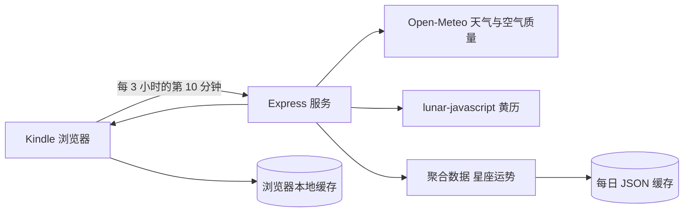

<div align="center">

# KindleReborn

### 让闲置 Kindle 变成一块安静、耐看的墨水屏信息板

[](https://nodejs.org/)
[](https://www.typescriptlang.org/)
[](LICENSE)

[在线体验](https://kindle.keyu.party/) · [Kindle 使用指南](#-kindle-使用指南) · [本地部署](#-本地部署)


</div>

KindleReborn 是一个专为 Kindle 与其他墨水屏设备设计的单页日历。它把时间、月历、天气、空气质量、逐小时预报、农历黄历、星座运势和次日穿衣建议压进一张 **560 × 780** 的黑白画布里。

没有动画、没有远程字体、没有厚重前端框架。页面采用高对比度排版和兼容旧版 WebKit 的基础 HTML/CSS/JavaScript，让一台吃灰的 Kindle 重新成为桌面上最克制的信息终端。

## 📖 Kindle 使用指南

无需安装，也无需越狱：

1. 将 Kindle 连接到 Wi-Fi，打开内置浏览器。
2. 访问 **[https://kindle.keyu.party/](https://kindle.keyu.party/)**。
3. 如需切换城市，在网址后加入城市参数，例如：

   ```text
   https://kindle.keyu.party/?city=广州
   ```

4. 将页面加入浏览器书签，下次可以直接打开；城市会自动保存在本机。
5. 如需把 Kindle 长期作为桌面信息屏，可返回主页，在搜索框输入 `~ds` 并确认，以关闭自动休眠。重启 Kindle 即可恢复自动休眠。

> `~ds` 会让设备保持唤醒并增加耗电，且可能不适用于部分新机型或固件。普通使用无需开启。

## ✨ 功能亮点

| 模块 | 内容 |
| --- | --- |
| 时间与日历 | UTC+8 分钟级时钟、公历月历、星期与农历日期 |
| 实时天气 | 温度、体感、湿度、风力、空气质量、紫外线、降水概率 |
| 趋势信息 | 四组逐小时天气与次日天气、穿衣建议 |
| 传统日历 | 每日宜忌，最多各显示 5 项 |
| 星座运势 | 综合、事业、财运、感情、健康、幸运色与幸运数字 |
| 墨水屏优化 | 每日 07:00、17:00 执行全黑→全白整屏重绘，缓解残影 |
| 弱网可用 | 浏览器本地缓存兜底；星座运势在服务端按天持久化 |

## 🧭 数据如何流动



- 天气、空气质量与地理编码来自 [Open-Meteo](https://open-meteo.com/)，无需 API Key。
- 黄历由 [lunar-javascript](https://github.com/6tail/lunar-javascript) 在服务端计算。
- 星座运势可选接入聚合数据 API；未配置时自动展示内置兜底内容。

## 🚀 本地部署

需要 Node.js 22 或更高版本。

```bash
git clone https://github.com/keyu-0915/KindleReborn.git
cd KindleReborn
npm install
cp .env.example .env
npm run dev
```

访问 `http://localhost:3000/`。通过查询参数切换城市：

```text
http://localhost:3000/?city=广州
```

城市会保存在浏览器本地，下次打开时继续使用。

## 🔐 环境变量

| 变量 | 必填 | 默认值 | 说明 |
| --- | --- | --- | --- |
| `PORT` | 否 | `3000` | 服务监听端口 |
| `CONSTELLATION` | 否 | `水瓶座` | 星座运势名称 |
| `JUHE_CONSTELLATION_KEY` | 否 | — | 聚合数据星座运势 API Key，仅在服务端使用 |

星座接口结果保存在 `data/constellation.json`，同一星座每天最多请求一次。不要把真实 Key 写入前端代码或提交到 Git。

## 🧰 常用命令

```bash
npm run dev      # 开发模式
npm run lint     # TypeScript 类型检查
npm run build    # 构建服务端产物
npm start        # 运行已构建产物
```

## 📁 项目结构

```text
KindleReborn/
├─ assets/             # 黑白天气 SVG 图标
├─ src/
│  ├─ app.js           # Kindle 端 ES5 风格脚本
│  └─ index.css        # 固定画布与旧 WebKit 兼容样式
├─ index.html          # 单页界面
└─ server.ts           # 天气、黄历、运势聚合服务
```

## 🖋️ 设计取舍

- 使用表格、浮动和基础 DOM API，优先兼容老 Kindle 浏览器。
- 所有图标均为本地黑白 SVG，不依赖图标字体或外部 CDN。
- 时钟每分钟更新一次。
- 天气每 3 小时的第 10 分钟更新，服务端缓存随三小时档位自动失效；星座运势按天缓存。
- 每日 07:00、17:00 执行黑白整屏重绘，缓解残影。
- 网页只能通过黑白整屏重绘缓解残影，无法直接调用 Kindle 的硬件全刷。

## 🤝 参与贡献

欢迎提交 Issue 或 Pull Request。若调整布局，请优先在 **560 × 780** 视口验证无横向或纵向溢出，并尽量保留旧版 WebKit 兼容性。

## 📄 许可证

[MIT](LICENSE) © 2026 keyu-0915

> 星座运势仅供娱乐，不应作为医疗、财务或其他重要决策依据。
