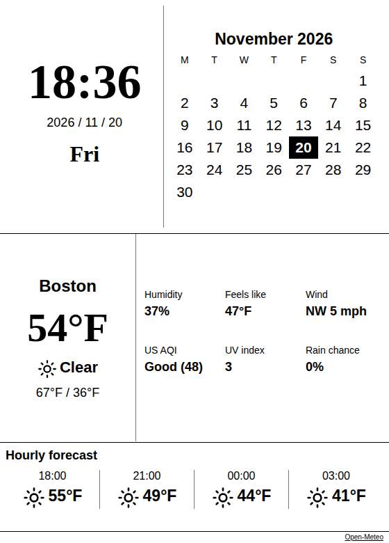
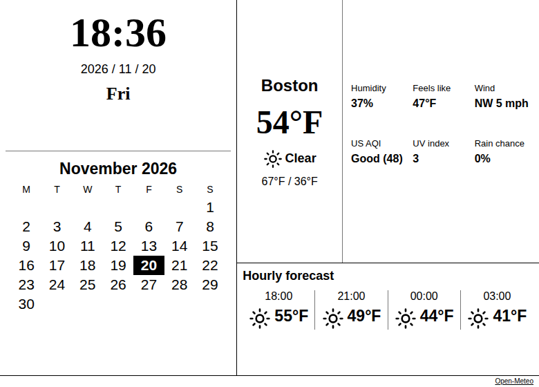

# KindleReborn

A static, monochrome calendar and weather dashboard for Kindle and other e-ink
browsers. No runtime application server, API keys, remote fonts, or framework.

## Screenshots

Browser captures of Boston using English and US units, with optional panels hidden.
These demonstrate the layouts, not verified rendering on Kindle firmware 5.16.2.

### Portrait (560 × 780)



### Landscape (780 × 560)



## Features

- International city/postal-code search with country/region selection.
- English and Chinese interfaces; US (°F, mph) and metric (°C, km/h) units.
  English/US is the default.
- Location-local clock and calendar with bundled timezone/DST rules.
- Enlarged clock/calendar, current weather, US AQI, and four hourly forecasts.
  Missing readings are shown as `--`, not invented values.
- Tap the city name immediately above the current temperature to open Settings;
  manual Refresh is available there, while weather continues to refresh automatically. No top banner,
  last-update timestamp, or persistent footer notes; loading/errors/stale-cache
  warnings appear in the weather widget only when needed. A small Open-Meteo
  attribution link remains at the bottom edge of the dashboard.
- Selectable portrait and landscape layouts.
- Optional lunar calendar and Chinese almanac, hidden by default. Hiding panels
  reclaims their space for the main calendar/weather layout.
- Per-location weather caching, explicit stale/error indicators, and guarded
  storage. The clock/calendar still work without storage or weather access.
- City-local 07:00/17:00 black/white redraws to help reduce e-ink ghosting.

Live horoscope is deferred: its previous provider requires a private API key.
No horoscope credentials or fabricated forecasts are shipped.

## Local development

Requires Node.js 22 or newer.

```sh
npm install
npm run dev
```

Open `http://localhost:3000/KindleReborn/`. Tap the weather widget's city heading
to open **Settings** (opened automatically on first use). Choose a city, select
the correct country/region, then configure language, units, layout, and panels.
Build output is static; the Node preview server is only a development tool.
Run `npm run dev` again after changing source files to rebuild.

```sh
npm test                # Data, settings, units, cache and timezone tests
npm run build           # Static public files in dist/
npm run lint            # ES5 syntax checks, including the built vendor bundle
npx playwright install chromium  # First browser-test setup
npm run test:browser    # Layout, settings, network/storage failures and resume
npm start               # Preview an existing build
```

## GitHub Pages deployment

1. Commit/push this branch when ready and merge into `main`. To run the workflow
   manually from a feature branch, the workflow must first exist on the default
   branch; GitHub does not expose a new branch-only workflow for manual dispatch.
2. In repository **Settings → Pages → Build and deployment**, select
   **GitHub Actions**.
3. The [Pages workflow](.github/workflows/pages.yml) builds and checks the site,
   uploads only `dist/`, and deploys it. If manually deploying this branch,
   ensure the `github-pages` environment permits that branch.
4. After the workflow succeeds, open its deployment URL. For this repository
   the default project URL is `https://yvetteywy.github.io/KindleReborn/`.

The URL is not live merely because these files exist locally. No deployment
secrets or application API keys are required. GitHub Pages serves static files;
the browser contacts Open-Meteo directly over HTTPS.

Relative asset paths work under a repository subpath or a custom domain.

## Kindle setup and compatibility

1. Connect the Kindle to Wi-Fi and enable JavaScript in its browser.
2. Open the deployed GitHub Pages URL.
3. Tap the city heading to open Settings and choose a city and display options.
   Use **Bookmark this configuration** to open a URL
   containing the selected location and settings, then bookmark it in the browser.
   This also works when local storage is unavailable.
4. Test portrait/landscape according to the browser's actual viewport.

The compatibility target is Kindle firmware **5.16.2**, not a verified guarantee.
Browser scripts are checked as ES5 and use XMLHttpRequest, basic DOM operations,
and table/float layouts. They do not require fetch, promises, modules, Intl,
service workers, CSS grid/flexbox, or viewport units.

**Actual Kindle testing is still required:** verify Pages HTTPS access, direct
weather/geocoding/AQI requests, settings controls, SVG icons, both orientations,
optional-panel layouts, readability, and sleep/resume behavior. Desktop tests
cannot reproduce all older WebKit/TLS/storage quirks. Landscape selects a layout;
it does not force the device/browser to rotate. On unusually small viewports,
scrolling may be necessary rather than reducing text to unreadable sizes.

The page cannot wake the Kindle, disable sleep, or trigger its hardware refresh.
Black/white redraws are only a browser-level mitigation for ghosting.

## Automatic updates and time

- Time updates every minute. The date/calendar changes at location-local midnight.
- Weather loads on opening the page or changing location, then at `00:10`,
  `03:10`, `06:10`, etc. in the city's timezone (within the minute timer's cadence).
- Focus/visibility events check for overdue updates after sleep. Timers and
  network requests can be suspended while the device sleeps.
- Failed weather requests keep the previous readings visibly marked stale and
  retry no more frequently than once per minute. **Refresh** in Settings permits
  a manual retry.
- Air-quality failure does not block weather; unavailable AQI is shown as `--`.
- Clock and traditional-calendar explanations are available in Settings rather
  than persistent dashboard footnotes. Clothing advice and tomorrow's weather
  panels have been removed to give the remaining widgets more space.

Time comes from the **device clock**, not an independent internet time service.
Keep the Kindle's clock accurate. Bundled moment-timezone data handles DST
without relying on the Kindle's Intl implementation or a fixed UTC+8 offset.
Rebuild with updated dependencies when governments change timezone rules.

## URL settings

`?city=Boston` opens a city search, requiring an explicit result selection.
An unambiguous bookmark includes coordinates and an IANA timezone:

```text
?latitude=42.36&longitude=-71.06&timezone=America%2FNew_York&name=Boston&language=en&units=us&orientation=landscape&lunar=0&almanac=0
```

| Parameter | Values |
| --- | --- |
| `language` | `en`, `zh` |
| `units` | `us`, `metric` |
| `orientation` | `portrait`, `landscape` |
| `lunar`, `almanac` | `1` to show, `0` to hide |
| `latitude`, `longitude` | Coordinates; both required |
| `timezone` | Supported IANA timezone; required with coordinates |
| `name`, `country`, `region` | Optional location labels |

URL settings override saved settings on each page load. After changing settings,
use the newly generated bookmark rather than an older URL containing overrides.

## Data and attribution

- [Open-Meteo](https://open-meteo.com/) supplies weather and US AQI.
- [Open-Meteo geocoding](https://open-meteo.com/en/docs/geocoding-api) uses GeoNames.
- [lunar-javascript](https://github.com/6tail/lunar-javascript) calculates the
  traditional calendar locally; English almanac terms use its bundled translations.
  The lunar date uses the selected city's Gregorian day. These are traditional
  Chinese cultural references, not universal recommendations.
- [moment-timezone](https://momentjs.com/timezone/) supplies IANA timezone rules.

Open-Meteo's free hosted API is for non-commercial use within its published
[terms and limits](https://open-meteo.com/en/terms). Check those terms before
commercial deployment; public endpoints may change or rate-limit requests.
City queries and selected coordinates are sent to the corresponding API, not
to a project application server. Settings/cache stay in the browser.

Built output includes dependency notices in `LICENSES.txt`.

## Structure

```text
index.html                 Dashboard and settings interface
src/app.js                 ES5 browser requests, controls, rendering and timers
src/core.js                Testable settings, data normalization and formatting
src/index.css              Portrait/landscape e-ink layouts
src/vendor.js              Build entry for locally bundled timezone/lunar libraries
assets/                    Local monochrome weather icons
scripts/                   Static build, preview and ES5 validation
tests/                     Unit and browser checks
.github/workflows/pages.yml GitHub Pages deployment
```

Contributor requirements are in [instruction.md](instruction.md); the approved
migration sequence is in [IMPLEMENTATION_PLAN.md](IMPLEMENTATION_PLAN.md).

## 中文说明

这是无需应用服务器的 Kindle 黑白日历天气页，可部署到 GitHub Pages。
在「设置」中选择城市、语言、单位及横竖屏布局；农历与黄历可分别显示或隐藏，
隐藏后其余内容会使用腾出的空间。默认使用英文及美制单位。
旧版 Kindle 固件 5.16.2 仍需要实际设备验证 HTTPS、跨域请求与显示效果。

## License

[MIT](LICENSE). Original KindleReborn © 2026 keyu-0915.
